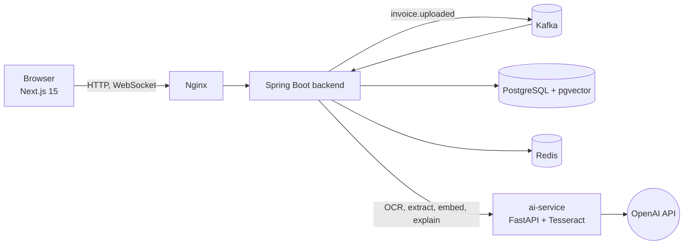

# InvoiceMind

Upload an invoice (PDF or photo), and InvoiceMind reads it with OCR, extracts the data with an LLM, checks the
arithmetic with deterministic rules, lets a human correct and approve it, and gives you analytics and exports.

It is built so that **the model is never trusted**: every value it returns must appear in the document, is
re-validated by plain Java code, and anything doubtful goes to a person.

> **Honest status.** Everything below runs and is tested, with one exception: the extraction and the knowledge-base
> answers call the OpenAI API, and in the environment this was built in there was no API key, so those calls are
> verified against fakes only. The accuracy numbers in `docs/EVALUATION.md` appear after the first real run
> (`docker compose --profile eval run --rm eval`). The full, itemised picture is in [docs/STATUS.md](docs/STATUS.md).

## What it does

| | |
|---|---|
| **Read** | PDFs with a text layer are read directly; scans and photos go through Tesseract (English, German, Russian). Per-page confidence is kept. |
| **Extract** | OpenAI structured output turns the text into vendor, number, dates, currency, line items, subtotal, tax, total, with per-field confidence. |
| **Verify** | Values are grounded against the OCR text; Java rules check sums, tax, dates, currency, duplicates; suspected prompt injection forces review. |
| **Review** | Document on the left, editable fields on the right; errors and low-confidence fields are highlighted; sums are re-checked as you type. |
| **Approve** | Roles, comments, four-eyes rule, full audit trail, notifications, live status over WebSocket. |
| **Understand** | Analytics from real data (spend by vendor and month, review rate, processing time, AI cost). Export to CSV, XLSX, JSON. |
| **Explain** | Upload your policies; "Why was this flagged?" answers from them with cited sources (RAG on pgvector). |

## Quick start (5 commands)

Requirements: Docker with Compose v2.

```bash
git clone <this repository> invoicemind && cd invoicemind
cp .env.example .env            # then put your key in OPENAI_API_KEY=
docker compose up --build       # first build takes a few minutes
# open http://localhost
```

Sign in with a seeded demo account (password is `DEMO_PASSWORD` from `.env`, default `Demo12345!`):

| Account | Role |
|---|---|
| `admin@demo.invoicemind.local` | ADMIN: everything, plus team and knowledge management |
| `approver@demo.invoicemind.local` | APPROVER: sees the whole organisation, approves and rejects |
| `user@demo.invoicemind.local` | USER: uploads, sees only their own invoices |

Or register your own organisation: you become its admin and can add your team. Set `DEMO_PASSWORD=` (empty) to disable seeding.

Without an `OPENAI_API_KEY` the application still starts; uploads then end as **Failed** with the message
"OPENAI_API_KEY is not configured" instead of producing made-up data.

### Demo walkthrough

1. **Upload** the PDFs and scans from [`samples/invoices`](samples/invoices) (drag several at once). Watch each one move
   through *Uploaded → OCR + AI → Validated*, live.
2. Open an invoice marked **Needs review**: the validation panel says exactly why (for example "Subtotal 1000 + tax 190 =
   1190, but the total is 1500"), the offending field is highlighted, and the sums check updates as you type. Fix it and press
   *Save & revalidate*.
3. As **approver**, open *Approvals*, approve with a comment, or reject with a reason. Everything lands in the *Audit log*.
4. *Analysis* shows spend and quality metrics computed from your data. *Export* downloads the filtered set as XLSX/CSV/JSON.
5. As admin, add a policy under *Knowledge* (for example "invoices above 10,000 EUR need two approvals") and press
   *Why was this flagged?* on an invoice: the answer cites the passage it came from.

## Architecture



Details, the lifecycle diagram, the Kafka-vs-`@Async` decision and the trust boundaries are in
[docs/ARCHITECTURE.md](docs/ARCHITECTURE.md).

| Part | Stack |
|---|---|
| `frontend/` | Next.js 15 (App Router), React 19, TypeScript, Tailwind v4, Radix UI, TanStack Query, Framer Motion, Recharts, STOMP.js, generated OpenAPI client |
| `backend/` | Spring Boot 3.4, Java 21, JPA + Flyway, Spring Security + JWT, Kafka, Redis, STOMP, Resilience4j, Apache POI, springdoc |
| `ai-service/` | Python 3.11, FastAPI, Pydantic v2, Tesseract + pdfplumber + Poppler, OpenAI Python SDK (Responses API) |
| infrastructure | PostgreSQL 16 with pgvector, Kafka (KRaft), Redis, Nginx, Docker Compose |

## Roles

| | USER | APPROVER | ADMIN |
|---|:-:|:-:|:-:|
| Upload, correct own invoices | ✓ | ✓ | ✓ |
| See other people's invoices, analytics for the organisation | – | ✓ | ✓ |
| Approve / reject | – | ✓ (not own uploads) | ✓ |
| Audit log, ask the knowledge base | – | ✓ | ✓ |
| Manage team, documents, delete invoices | – | – | ✓ |

## Configuration

Everything is an environment variable; see [`.env.example`](.env.example) (secrets are never committed).

| Variable | Meaning |
|---|---|
| `OPENAI_API_KEY` | required for extraction and the knowledge base |
| `OPENAI_MODEL` / `OPENAI_REASONING_EFFORT` | extraction model (default `gpt-6-luna`) and reasoning effort |
| `OPENAI_PRICE_INPUT_PER_1M` / `OPENAI_PRICE_OUTPUT_PER_1M` | only used to store an estimated cost per invoice |
| `OPENAI_EMBEDDING_MODEL` | knowledge-base embeddings (default `text-embedding-3-small`) |
| `JWT_SECRET`, `AI_SERVICE_TOKEN`, `POSTGRES_PASSWORD` | change the development values for anything real |
| `DEMO_PASSWORD` | password of the three seeded demo users; empty disables seeding |
| `HTTP_PORT` | published port (default 80) |

Behind TLS, also set `APP_COOKIES_SECURE=true` for the backend so the refresh cookie gets the `Secure` flag.

## API

Interactive docs: **`/swagger-ui.html`** (OpenAPI at `/v3/api-docs`). Main groups: `auth`, `invoices` (upload, list with filters
and paging, detail, correct, approve, reject, retry, file, OCR text, audit), `analytics`, `export`, `users`, `audit`, `notifications`,
`knowledge`. Live updates: STOMP over WebSocket at `/ws/live`.

## Development

```bash
# stack with ports exposed on 127.0.0.1 (backend :18080, ai-service :18000)
docker compose -f docker-compose.yml -f docker-compose.dev.yml up --build

cd frontend && npm ci && npm run dev          # http://localhost:3000, proxies /api to the backend
```

### Tests

```bash
cd backend && mvn verify                                         # 85 tests; needs Docker (Testcontainers)
docker build --target test -t im-ai-test ai-service && docker run --rm im-ai-test   # 32 tests, real Tesseract/Poppler
cd frontend && npm run lint && npm run typecheck && npm test     # 23 unit tests

# browser end-to-end on the full stack, with an offline AI test double (no API key, no cost)
docker compose -f docker-compose.yml -f docker-compose.e2e.yml up --build -d --wait
cd frontend && npx playwright install chromium && E2E_BASE_URL=http://localhost npx playwright test   # 8 scenarios
```

CI (`.github/workflows/ci.yml`) runs all of the above plus a check that the generated TypeScript API types match the backend.

The e2e overlay swaps the OpenAI-backed service for [`e2e/fake-ai`](e2e/fake-ai): real OCR and a rule-based extractor.
It exists only for tests and is never part of the normal stack.

### Measuring extraction quality

[`samples/`](samples) holds 16 synthetic invoices with ground truth: text PDFs and scans (rotation, noise, blur), EUR/USD/GBP/CHF/RUB,
English/German/Russian, decimal point and comma, a multi-page invoice, look-alike identifiers and a hidden prompt injection.

```bash
docker compose --profile eval run --rm eval       # real OCR + real model; writes docs/EVALUATION.md
node scripts/capture-screenshots.cjs              # seeds the demo org with the samples and captures screenshots
```

## Security notes

Upload hardening (magic bytes, size, active PDF content), untrusted-data prompts with nonce delimiters, schema-validated output,
grounding, organisation-scoped everything, rotating refresh tokens with theft detection, rate limiting, CSV/XLSX formula
neutralisation, audit trail. The full model is in [docs/ARCHITECTURE.md](docs/ARCHITECTURE.md#security-model).

## Known limitations

- **Real-LLM behaviour is not yet measured** (see the status note at the top); the evaluation set is synthetic and small, so its numbers will be indicative, not an SLA.
- Access tokens live 15 minutes: disabling a user or changing a role takes effect for already-issued tokens at their expiry (refresh is blocked immediately). An open WebSocket stays authorised until it reconnects.
- Credit notes and zero-value invoices are rejected by validation; spend is never converted between currencies.
- Files are stored on a local volume (no S3); Kafka and Redis run as single nodes.
- Tesseract languages are English, German and Russian; other scripts need more language packs in the `ai-service` image.
- The PDF active-content scan is a keyword check and cannot look inside compressed streams; PDFs are only ever rendered by the user's own browser.
- The compose file is for a single host. Terminate TLS in front of Nginx for anything public.

## Roadmap

PaddleOCR engine, credit notes, currency conversion, e-mail ingestion, ERP integrations, SSO, OpenTelemetry tracing, S3 storage.

## Repository layout

```text
backend/      Spring Boot API, pipeline, validation, knowledge base      (+ Flyway migrations, tests)
ai-service/   OCR and every OpenAI call                                   (+ pytest suite)
frontend/     Next.js application                                         (+ vitest, Playwright)
samples/      synthetic invoices, ground truth, generator
eval/         accuracy evaluation harness
e2e/          offline AI test double for browser tests
docker/       Nginx configuration
docs/         ARCHITECTURE, STATUS, EVALUATION (generated), AUDIT-PHASE0 (history)
scripts/      screenshot capture
```
