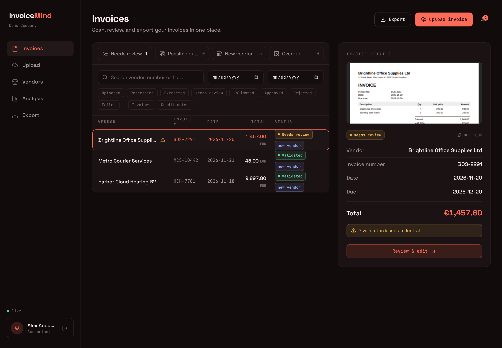
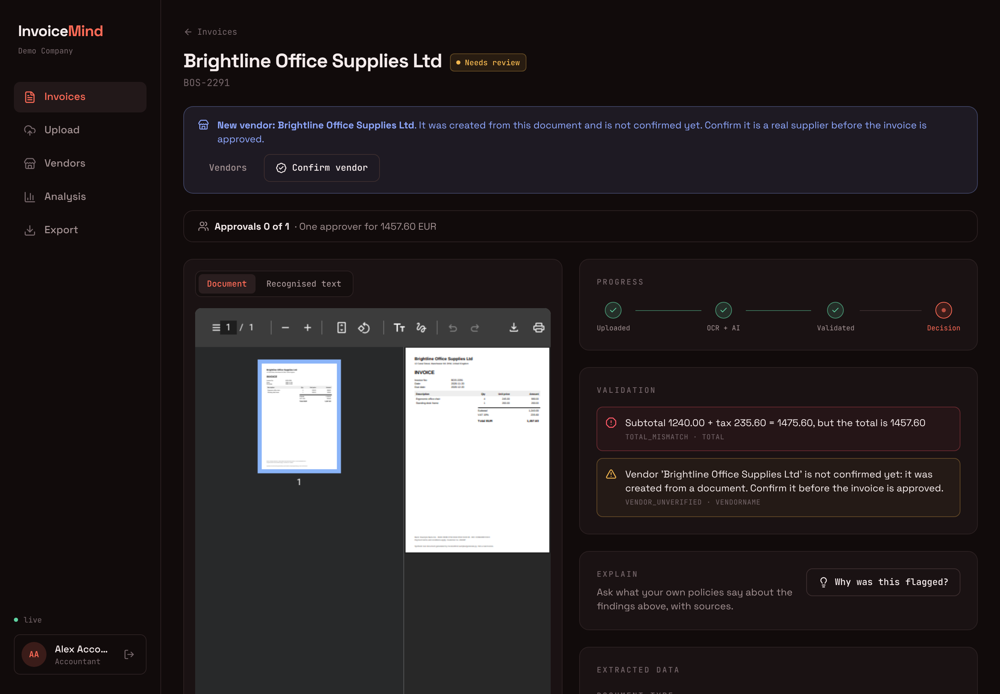
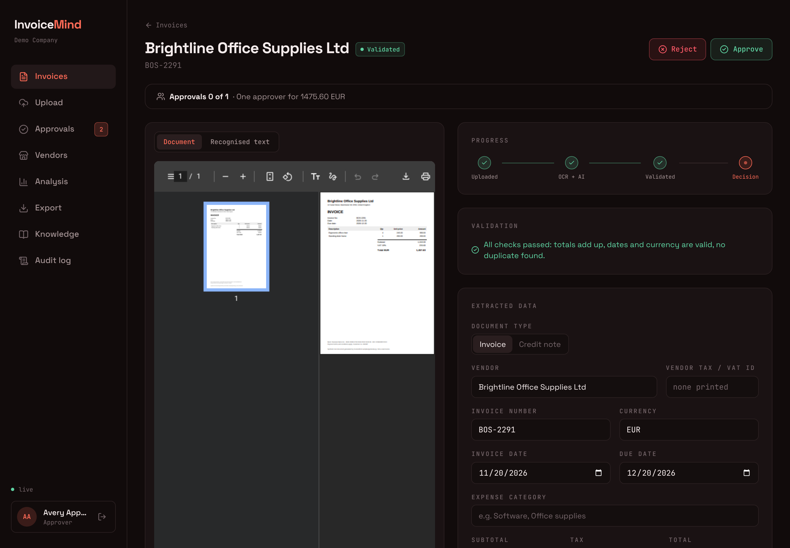
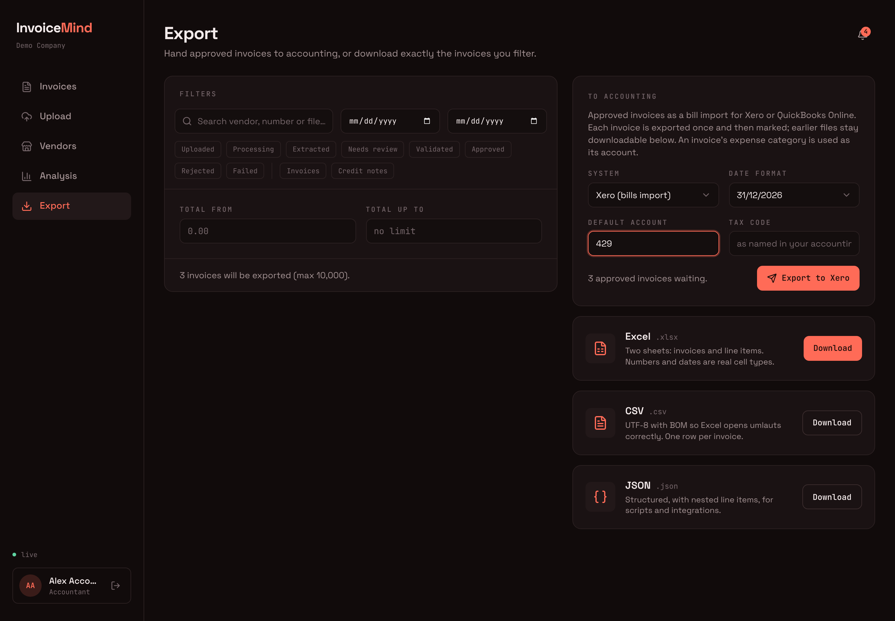
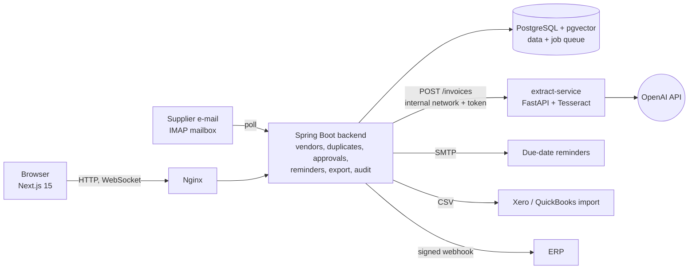
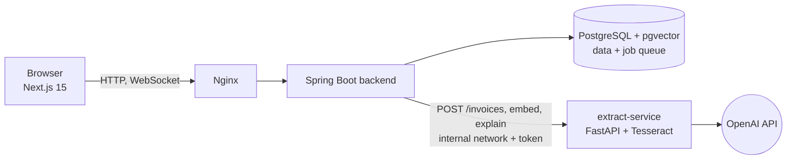

# InvoiceMind

**Accounts payable teams retype every supplier invoice by hand and still pay some of them twice; InvoiceMind takes
invoices from e-mail and uploads, extracts them with OCR and an LLM, lets plain code check every number and catch
duplicates, sends only the failed checks to a person, and hands approved invoices to Xero or QuickBooks exactly once.**

The model only reads. Code validates, computes, deduplicates and decides who may do what: every extracted value must
appear in the document, Java re-checks the arithmetic, dates, currency and duplicates, and anything that fails goes
to review.

## The flow: e-mail → review → approve → export

| 1. Arrives by e-mail, one check fails | 2. The accountant sees exactly why |
|---|---|
| [](docs/screenshots/flow-1-inbox.png) | [](docs/screenshots/flow-2-review.png) |
| **3. After the fix, an approver approves** | **4. Approved invoices go to accounting once** |
| [](docs/screenshots/flow-3-approve.png) | [](docs/screenshots/flow-4-export.png) |

A supplier e-mails invoice BOS-2291 to the organisation's intake address. Its printed total has two digits swapped,
so the deterministic check flags it (*subtotal 1240.00 + tax 235.60 = 1475.60, but the total is 1457.60*) and the new
vendor must be confirmed. The accountant fixes the total; the approval rule for EUR (automatic below 100, one approver
up to 5,000, two above) asks for one approver; a second invoice of 9,897.80 EUR needed two different approvers and a
45 EUR one was approved automatically. The export marks all three so they are never exported again.

*Captured by [`scripts/demo-flow.cjs`](scripts/demo-flow.cjs) on the local stack (real backend, database, IMAP
mailbox, OCR and browser). The values in these screenshots were extracted by the offline rule-based test double
(`e2e/fake-ai`), because the build environment had no OpenAI key; with a key the same flow uses the model.*

## Evaluation

| | Current set: 32 documents, full `POST /invoices` pipeline | Previous run, 2026-10-15 |
|---|---|---|
| Model | not run yet (needs an OpenAI key: `docker compose --profile eval run --rm eval`) | `gpt-5.5`, reasoning effort `none` |
| Documents | 32 synthetic: 22 text PDFs, 10 scans (2 scanned PDFs), 4 multi-page, 6 multi-rate VAT, 4 with discounts, 2 credit notes | the first 18 of them, before the "synthetic" footer was added |
| Per-field accuracy (vendor, number, date, currency, subtotal, tax, total) | not run yet | 100 % on every field |
| Line items | not run yet | 70 of 70 rows, none invented |
| Auto-validated vs needs review | not run yet | measured differently then: 16 passed, 2 correct documents flagged |
| False "valid" (wrong but auto-validated) | not run yet | 0 (no document had a wrong value) |
| Average latency per invoice | not run yet | 3.6 s (slowest 6.3 s) |
| Average cost per invoice | not run yet | about 1,250 input + 230 output tokens; not priced |

The previous run used the earlier AI service (no deterministic validation step), so its numbers are history, not a
baseline. What each metric means, how the spend cap (`EVAL_MAX_COST_USD`) works and how to add real redacted invoices:
[docs/evaluation.md](docs/evaluation.md). The metric code is tested (`extract-service/tests/test_eval_metrics.py`).

## Architecture



The extract-service has no published port: only the backend reaches it, on an internal Docker network, with a
service token. Uploads are queued in a Postgres table and processed by workers with `SELECT … FOR UPDATE SKIP LOCKED`
(no Kafka, no Redis). Details: [docs/ARCHITECTURE.md](docs/ARCHITECTURE.md).

## Honest limitations

- **Accuracy on real mail is not measured yet.** The evaluation set is synthetic, and the current pipeline has not been
  run against the real model in this repository's history (see above). Real invoices will be messier.
- **The README screenshots use the offline test double**, not the model (see the note under them).
- **Xero's column headers were not checked against a template downloaded from Xero**, and QuickBooks' optional column
  names were read from Intuit's help pages, not a live import. Try one import in each before relying on it
  ([docs/ACCOUNTING-EXPORT.md](docs/ACCOUNTING-EXPORT.md)).
- **E-mail intake needs your own IMAP mailbox** with plus-addressing (Gmail, Outlook, Fastmail …); it was tested against
  GreenMail, not against those providers. It polls (no IMAP IDLE).
- **Vendor memory is a set of deterministic rules** (currency, payment terms, category, name aliases learned from
  corrections), not model training. **Duplicate detection** is exact rules (same vendor + number, same file, or same
  vendor + total + currency within 7 days for a person to decide), not fuzzy matching of content.
- More in [Known limitations](#known-limitations).

## What it does

| | |
|---|---|
| **Intake** | Upload PDFs and photos, a whole `.zip` at once, or let suppliers e-mail them to the organisation's address (IMAP). |
| **Read** | PDFs with a text layer are read directly; scans and photos go through Tesseract (English, German, Russian). |
| **Extract** | OpenAI structured output; money travels as decimal strings (`BigDecimal` / `Decimal`, never float), currency next to every amount. |
| **Verify** | Values are grounded against the document text; Java rules check sums, tax, dates, currency; suspected prompt injection forces review. |
| **Deduplicate** | Same vendor + number or the identical file is a duplicate (the stored extraction is reused, the model is not called again); same vendor, total and currency within 7 days is a *possible* duplicate a person decides. |
| **Review** | Queues for *needs review*, *possible duplicate*, *new vendor* and *overdue*; field-level corrections are recorded; vendor memory fills in what this vendor's invoices needed last time, marked as such. |
| **Approve** | ACCOUNTANT / APPROVER / ADMIN; rules per currency (automatic below X, one approver up to Y, two different approvers above Y); nobody approves their own upload; any edit resets approvals. |
| **Remind** | A daily e-mail digest of invoices overdue or due within 3 days, sent once per organisation and day. |
| **Export** | Xero and QuickBooks Online bill-import CSV; each invoice is exported once and then leaves the reminders. Also XLSX/CSV/JSON and a signed `invoice.approved` webhook. |
| **Explain** | Upload your policies; "Why was this flagged?" answers from them with cited sources (RAG on pgvector). |
| **More** | Credit notes, currency conversion at ECB rates, analytics, multi-client firms, single sign-on (OIDC), S3 storage, OpenTelemetry tracing. |

## Quick start (5 commands)

Requirements: Docker with Compose v2.

```bash
git clone <this repository> invoicemind && cd invoicemind
cp .env.example .env            # then put your key in OPENAI_API_KEY=
docker compose up --build       # first build takes a few minutes
# open http://localhost
```

http://localhost shows a short landing page to visitors who are not signed in (with links to sign in and register); signed-in people go straight to their invoices.

Sign in with a seeded demo account (password is `DEMO_PASSWORD` from `.env`, default `Demo12345!`):

| Account | Role |
|---|---|
| `admin@demo.invoicemind.local` | ADMIN: everything, plus team, approval rules, e-mail intake and knowledge management |
| `accountant@demo.invoicemind.local` | ACCOUNTANT: uploads, reviews and corrects, confirms vendors, exports; does not approve |
| `approver@demo.invoicemind.local` | APPROVER: sees the whole organisation, approves and rejects |
| `approver2@demo.invoicemind.local` | APPROVER: the second person for invoices that need two approvals |

The demo organisation also gets approval rules for EUR, USD and GBP (automatic below 100, two approvers above 5,000).
No invoices are seeded: they go through the real pipeline (see the walkthrough). Or register your own organisation:
you become its admin and can add your team. Set `DEMO_PASSWORD=` (empty) to disable seeding.

Without an `OPENAI_API_KEY` the application still starts; uploads then end as **Failed** with the message
"OPENAI_API_KEY is not configured" instead of producing made-up data.

### Demo walkthrough

The screenshots above come from this, scripted end to end:

```bash
node scripts/demo-flow.cjs http://localhost           # needs e-mail intake configured (MAIL_INGEST_* in .env)
```

It e-mails [`samples/demo/demo-email-invoice.pdf`](samples/demo) (or asks you to send it), uploads two more documents,
waits for processing, corrects the flagged total as the accountant, confirms the vendors, approves as the approvers
and exports to Xero. By hand:

1. As **accountant**, upload the files in [`samples/demo`](samples/demo) (or any of [`samples/invoices`](samples/invoices)),
   or e-mail them to the address under *Settings → E-mail ingestion*. Each moves through *Uploaded → OCR + AI → Validated* live.
2. Open the queue **Needs review**: the validation panel says exactly why, the offending field is highlighted, and the sums
   check updates as you type. Fix it, press *Save & revalidate*, and confirm the new vendor.
3. As **approver**, approve with a comment or reject with a reason. Above the two-approver limit a second, different
   approver is needed. Everything lands in the *Audit log*.
4. As accountant, *Export → To accounting* produces the Xero or QuickBooks file; the invoices are marked and not offered again.
5. As admin, add a policy under *Knowledge* and press *Why was this flagged?* on an invoice: the answer cites the passage.

## Duplicates, vendors and vendor memory

- **Duplicates by meaning.** Same vendor + same invoice number (also a re-scan or a resend as another file) is a
  duplicate and cannot be approved. Same vendor + same total within 7 days but another number is a *possible*
  duplicate: a person decides. An identical file reuses the stored result: the model is not called again. Rules and
  examples: [docs/ARCHITECTURE.md](docs/ARCHITECTURE.md#vendors-and-duplicates).
- **Vendors.** Matched by tax/VAT id first, then by name or alias; an unknown vendor is created *unverified* and must
  be confirmed once (*Vendors* page or on the invoice) before its invoices can be approved.
- **Vendor memory is not model training.** When a person corrects an invoice, InvoiceMind stores plain rules for that
  vendor: "this vendor's `USD` means `CAD`", "no due date printed: invoice date + 30 days", "expense category:
  Hosting", "the misread name *Northwlnd Traders Ltd* is this vendor". They are applied to the vendor's next invoices
  by ordinary code, each filled-in field is marked *from vendor memory*, and every rule is listed on the *Vendors* page
  where it can be removed. Nothing is sent to the model and no model is fine-tuned.
- **Review queues.** *Needs review*, *Possible duplicate*, *New vendor* and *Overdue*, with counts, on the invoice list.
  Every correction is stored field by field (before, after, who, when) and shown on the invoice.

## Optional features

Off by default; each is switched on with environment variables (all listed, with comments, in [`.env.example`](.env.example)).
What "verified" means for each one is in [docs/STATUS.md](docs/STATUS.md).

| Feature | Switch on | Where it shows up |
|---|---|---|
| **Credit notes** | always on: the model reports `document_type`, a reviewer can change it | *Credit* badge and type filter in the list; amounts stored negative |
| **Currency conversion** | automatic with several currencies; `FX_RATES_ENABLED=false` for offline use | *Analysis* ("All in EUR"), *Settings* (reporting currency, manual rates) |
| **Webhooks** | admin: *Integrations* → Add webhook | `invoice.approved`, `.rejected`, `.validated`, `.needs_review`, `.failed`, HMAC-signed, retried, delivery log |
| **E-mail ingestion** | `MAIL_INGEST_ENABLED=true` + `MAIL_INGEST_ADDRESS`, `MAIL_IMAP_*` | *Settings* shows your address `invoices+<token>@your-domain` |
| **Single sign-on** | `OIDC_ENABLED=true` + issuer, client id/secret; register `<app url>/api/v1/auth/oidc/callback` at the provider | "Continue with …" button on the login page |
| **S3 storage** | `STORAGE_TYPE=s3` and the `S3_*` variables (AWS S3, MinIO, SeaweedFS ...) | invoice files in a bucket instead of a volume |
| **Tracing** | `TRACING_ENABLED=true` and `OTEL_EXPORTER_OTLP_ENDPOINT` of any OTLP/HTTP collector (Jaeger, Tempo ...) | one trace per upload across backend, the job queue and extract-service |

### Webhooks: verifying a request

Every delivery carries `X-InvoiceMind-Signature: t=<unix seconds>,v1=<hex>` where `v1` is the HMAC-SHA256, keyed with the
secret shown once when you create the webhook, of `"<t>.<raw body>"`. Reject old timestamps (replay) and deduplicate on the
event's `id` (delivery is at-least-once; failed deliveries are retried with exponential backoff for about an hour). Webhook
URLs are requested by the server, so private, loopback and link-local addresses are refused and redirects are never followed
(`WEBHOOKS_ALLOW_PRIVATE_TARGETS=true` for a receiver inside your own network). A Node.js example is on the *Integrations* page.

### E-mail ingestion: how mail is accepted

Each organisation has an address `invoices+<token>@your-domain` (shown under *Settings*; the token routes the mail to
the organisation, rotate it if it leaks). Give it to your vendors or forward invoices to it.

- **Who may send** (per organisation, *Settings*): *anyone*, the default for new organisations (vendors mail their
  invoices; the document is attributed to the organisation's "E-mail intake" service account, or to the sender if
  that is a user), or *only people of this organisation*. The sender is stored on the invoice.
- Only PDF and image attachments are imported, through the same checks as an upload. **The mail text is untrusted and
  never sent to the AI**; text parts and forwarded messages are ignored.
- **E-mailed invoices are never approved automatically**, whatever the approval rules say: a sender address is easy
  to forge. `MAIL_REQUIRE_AUTH_RESULTS=true` additionally demands `dkim=pass` or `spf=pass` from your mail server.
- Idempotent by `Message-ID`: a message is claimed before anything is stored and flagged as read only after its
  documents are queued; one that failed for a transient reason stays unread and is tried again.
- The mailbox is polled every minute (no IMAP IDLE); any IMAP mailbox with plus-addressing works (use an app password).

### Batch upload

Drop several files at once, or a `.zip` of them, on *Upload*. In a zip, every PDF or image becomes an invoice and every
other entry is listed with the reason it was skipped. Limits are counted while unpacking (the sizes a zip declares
are not trusted): `BATCH_MAX_ENTRIES` (50) documents and `BATCH_MAX_TOTAL_BYTES` (200 MB) unpacked; entries with an
absolute path or `..` are refused, archives inside the archive are not opened.

### Single sign-on: how accounts are linked

People must already have an account (the first SSO login is matched by *verified* e-mail and then pinned to the provider's
stable subject, so a reassigned address cannot take the account over), or set `OIDC_PROVISION_ORG_ID` and
`OIDC_ALLOWED_EMAIL_DOMAINS` to create accounts on first sign-in with `OIDC_DEFAULT_ROLE`. Roles are not mapped from provider
groups; an admin changes them under *Team*.

## Architecture



Details, the lifecycle diagram, the job-queue decision and the trust boundaries are in
[docs/ARCHITECTURE.md](docs/ARCHITECTURE.md).

| Part | Stack |
|---|---|
| `frontend/` | Next.js 15 (App Router), React 19, TypeScript, Tailwind v4, Radix UI, TanStack Query, Framer Motion, Recharts, STOMP.js, generated OpenAPI client |
| `backend/` | Spring Boot 3.4, Java 21, JPA + Flyway, Spring Security + JWT, STOMP, Resilience4j, Apache POI, springdoc |
| `extract-service/` | Python 3.11, FastAPI, Pydantic v2 (money as `Decimal`), Tesseract + pdfplumber + Poppler, OpenAI Python SDK (Responses API). Imported from InvoiceExtract with `git subtree` (its history is kept) and merged with the former `ai-service` |
| infrastructure | PostgreSQL 16 with pgvector (also the job queue and rate-limit counters), Nginx, Docker Compose |

## Export to accounting

*Export → To accounting* (accountants and admins) turns every approved, not yet exported invoice into a bill-import
CSV for **Xero** or **QuickBooks Online**, marks those invoices and never exports them twice; earlier files stay
downloadable. Exported invoices leave the *Overdue* queue and the reminders. Exact columns, sources and what could not
be verified: [docs/ACCOUNTING-EXPORT.md](docs/ACCOUNTING-EXPORT.md). Systems that should react at once get the signed
`invoice.approved` webhook instead (below).

## Roles and approvals

| | ACCOUNTANT | APPROVER | ADMIN |
|---|:-:|:-:|:-:|
| See every invoice of the organisation, upload, review and correct, confirm vendors | ✓ | ✓ | ✓ |
| Approve / reject (never their own uploads) | – | ✓ | ✓ |
| Audit log, ask the knowledge base | – | ✓ | ✓ |
| Team, approval rules, settings, integrations, delete invoices | – | – | ✓ |

**Approval rules** (*Settings*, per currency): below the first amount an invoice is approved automatically once it
passed every check and its vendor is confirmed; up to the second amount one approver decides; above it two different
approvers. Nobody approves their own upload, admins included. A correction after the first approval resets the
approvals. A currency without a rule needs one approver. Credit notes count by their amount.

**Due dates and reminders.** The due date is the one printed on the invoice, otherwise invoice date + the vendor's
payment terms (set on *Vendors* or learned from a correction). Every morning (05:37 UTC, `REMINDERS_CRON`) each
accountant, approver and admin gets one e-mail listing the open invoices that are overdue or due within
`REMINDERS_DAYS_AHEAD` (3) days; one digest per organisation and day. Locally the mails land in Mailpit
(http://127.0.0.1:8025); set `SMTP_*` for a real mail server.

## Multi-client firms

An accounting firm works for several client companies. A **firm** sits above its **client companies** (organisations):
each client stays a separate data tenant with its own invoices, team, audit trail, knowledge base, webhooks and
reporting currency; the firm only decides who may enter which client. Nothing changes for a company that registers on its
own: it is a firm of one with a single client (itself), and the extra screens only appear when there is something to switch.

- **Firm roles.** `FIRM_ADMIN` reaches every client of the firm (as ADMIN there) and manages clients and the firm team.
  `ACCOUNTANT` reaches only the clients they were given, with the role they were given there (a person can be an approver
  for one client and a plain user for another).
- **Switching.** The client switcher (sidebar, only for people who can reach more than one client; searchable) asks the
  server for a token for the chosen client (`POST /api/v1/auth/switch-organization`). The server checks the database, not the
  old token; "no such client" and "not yours" give the identical 403. The page's cache is reset and the live connection
  reconnects with the new token. The chosen client is stored with the refresh token, so a reload or a token refresh stays in
  it; if access has been withdrawn in the meantime, the next refresh lands in the person's home client.
- **Firm clients** (`/firm/clients`): documents, in review, awaiting approval, failed, and the approved total of the current
  month per client, from one grouped query. The total counts only invoices already in the client's reporting currency;
  approved invoices in other currencies are shown as a count, never converted behind your back. A row opens that client.
- **Firm team** (`/firm/team`): the access matrix (person × client, with the role there). New accountants start with one client
  (their home, where they land on sign-in) and get more in the table. Removing a person disables the account.
- **Monthly document limit.** `firms.monthly_document_limit` (null = unlimited, the default) caps the uploads of the whole firm
  per calendar month (UTC), summed over all of its clients, including mail ingestion. Over the limit an upload answers
  `402 firm_limit_reached` with a message, and the refusal is audited. There is no billing and no UI to set the limit; it is
  a column an operator sets: `update firms set monthly_document_limit = 200 where id = '…'`.
- **Audit.** `ORG_SWITCH` (in both clients), `CLIENT_CREATED`, `CLIENT_UPDATED`, `CLIENT_DEACTIVATED`, `ACCESS_GRANTED`,
  `ACCESS_CHANGED`, `ACCESS_REVOKED`, `FIRM_LIMIT_REACHED`.

| Endpoint | Who |
|---|---|
| `GET /api/v1/auth/organizations`, `POST /api/v1/auth/switch-organization` | anyone signed in (the result is limited to what they may enter) |
| `GET /api/v1/firm`, `GET /api/v1/firm/clients` | firm members (an accountant sees only their clients) |
| `POST /api/v1/firm/clients`, `PUT /api/v1/firm/clients/{id}`, `POST …/{id}/deactivate`, `POST …/{id}/activate` | firm admins |
| `GET/POST /api/v1/firm/members`, `PUT/DELETE /api/v1/firm/members/{userId}/access/{clientId}`, `DELETE /api/v1/firm/members/{userId}` | firm admins |

## Configuration

Everything is an environment variable; see [`.env.example`](.env.example) (secrets are never committed).

| Variable | Meaning |
|---|---|
| `OPENAI_API_KEY` | required for extraction and the knowledge base |
| `OPENAI_MODEL` / `OPENAI_REASONING_EFFORT` | extraction model (default `gpt-5.5`) and reasoning effort |
| `OPENAI_PRICE_INPUT_PER_1M` / `OPENAI_PRICE_OUTPUT_PER_1M` | only used to store an estimated cost per invoice |
| `OPENAI_EMBEDDING_MODEL` | knowledge-base embeddings (default `text-embedding-3-small`) |
| `JWT_SECRET`, `EXTRACT_SERVICE_TOKEN`, `POSTGRES_PASSWORD` | change the development values for anything real |
| `DEMO_PASSWORD` | password of the three seeded demo users; empty disables seeding |
| `HTTP_PORT` | published port (default 80) |
| `FX_RATES_ENABLED` | download ECB reference rates for currency conversion (default true; only dates are sent) |
| `STORAGE_TYPE`, `S3_*` | `local` volume (default) or an S3-compatible bucket |
| `MAIL_INGEST_ENABLED`, `MAIL_INGEST_ADDRESS`, `MAIL_IMAP_*`, `MAIL_REQUIRE_AUTH_RESULTS` | e-mail ingestion |
| `OIDC_ENABLED`, `OIDC_ISSUER_URI`, `OIDC_CLIENT_ID`, `OIDC_CLIENT_SECRET`, `OIDC_PROVISION_ORG_ID`, ... | single sign-on |
| `WEBHOOKS_ALLOW_PRIVATE_TARGETS` | allow webhooks to private addresses (SSRF guard, default false) |
| `TRACING_ENABLED`, `OTEL_EXPORTER_OTLP_ENDPOINT` | OpenTelemetry tracing |

Behind TLS, also set `APP_COOKIES_SECURE=true` for the backend so the refresh cookie gets the `Secure` flag.

## API

Interactive docs: **`/swagger-ui.html`** (OpenAPI at `/v3/api-docs`). Main groups: `auth`, `invoices` (upload, list with filters
and paging, detail, correct, approve, reject, retry, file, OCR text, audit), `analytics`, `export`, `users`, `audit`, `notifications`,
`knowledge`, `organization`/`fx` (reporting currency, rates), `webhooks`, `ingest/email`, `auth/oidc`. Live updates: STOMP over WebSocket at `/ws/live`.

## Development

```bash
docker compose up --build                       # the whole stack on http://localhost (real OpenAI-backed extract-service)

# frontend development with hot reload; needs the backend reachable on the host, which the browser-test overlay publishes
# on 127.0.0.1:18080 (it swaps the AI service for the offline test double: no key, no cost)
docker compose -f docker-compose.yml -f docker-compose.e2e.yml up --build -d
cd frontend && npm ci && BACKEND_INTERNAL_URL=http://127.0.0.1:18080 npm run dev     # http://localhost:3000
```

### Tests

```bash
cd backend && mvn verify                                         # 170 tests; needs Docker (Testcontainers)
docker build --target test -t im-extract-test extract-service && docker run --rm im-extract-test   # pytest with real Tesseract/Poppler; LIVE_OPENAI_SMOKE=1 + OPENAI_API_KEY adds the live smoke test
cd frontend && npm run lint && npm run typecheck && npm test     # 49 unit tests

# browser end-to-end on the full stack, with an offline AI test double (no API key, no cost)
docker compose -f docker-compose.yml -f docker-compose.e2e.yml up --build -d --wait
cd frontend && npx playwright install chromium && E2E_BASE_URL=http://localhost npx playwright test   # 23 scenarios
```

CI (`.github/workflows/ci.yml`) runs all of the above plus a check that the generated TypeScript API types match the backend.

The e2e overlay swaps the OpenAI-backed extract-service for [`e2e/fake-ai`](e2e/fake-ai): real OCR and a rule-based extractor.
It exists only for tests and is never part of the normal stack.

### Measuring extraction quality

[`samples/`](samples) holds 32 synthetic invoices (labelled as such) with ground truth: text PDFs, scans and scanned PDFs, multi-page,
multi-rate VAT, discounts, credit notes, EUR/USD/GBP/CHF/RUB/SEK, English/German/Russian, decimal point and comma, look-alike
identifiers and a hidden prompt injection. Real redacted invoices go to `samples/real/`.

```bash
EVAL_MAX_COST_USD=1 docker compose --profile eval run --rm eval   # real pipeline + model; writes docs/evaluation.md
node scripts/demo-flow.cjs http://localhost       # the demo flow; captures docs/screenshots/flow-*.png
```

## Security notes

Upload hardening (magic bytes, size, active PDF content), untrusted-data prompts with nonce delimiters, schema-validated output,
grounding, organisation-scoped everything, rotating refresh tokens with theft detection, rate limiting, CSV/XLSX formula
neutralisation, audit trail. The full model is in [docs/ARCHITECTURE.md](docs/ARCHITECTURE.md#security-model).

## Known limitations

- The evaluation set is synthetic (32 documents) and the current pipeline has not been measured with the real model yet; see [Evaluation](#evaluation).
- Access tokens live 15 minutes: disabling a user or changing a role takes effect for already-issued tokens at their expiry (refresh is blocked immediately). An open WebSocket stays authorised until it reconnects.
- Firms: an e-mail address belongs to one account, so one person cannot work as two separate users for two firms (inside a firm one account reaches many clients). Taking access away, deactivating a client or removing a team member shows in a session that is already open only when its 15-minute token expires (`/auth/me` and refresh check at once). Deactivating a client does not lock out people whose home company it is. The monthly limit is checked per upload without a lock, so simultaneous uploads can overshoot it by a few documents; it counts uploads recorded in the audit trail, so deleting a document does not give the quota back. The firm clients total does not convert currencies. There is no screen to edit a client's name or currency or to set the limit (the API for the first two exists).
- Zero-value invoices are rejected by validation. Currency conversion uses one rate per invoice date (no hedging, no month-end revaluation); the ECB does not publish every currency, those need manual rates.
- Webhook delivery is at-least-once, so receivers must deduplicate on the event id. The signing secret is stored in the database in clear (it must be, to sign); protect database access accordingly.
- E-mail ingestion polls one mailbox every minute (no IMAP IDLE) and trusts the `From` address unless `MAIL_REQUIRE_AUTH_RESULTS=true`.
- Single sign-on maps no roles from provider groups, and sign-out does not end the session at the provider.
- Tesseract languages are English, German and Russian; other scripts need more language packs in the `extract-service` image.
- The PDF active-content scan is a keyword check and cannot look inside compressed streams; PDFs are only ever rendered by the user's own browser.
- The compose file is for a single host. Terminate TLS in front of Nginx for anything public.

## Roadmap

Provider-group to role mapping for SSO, IMAP IDLE, connectors for specific ERP systems (the webhooks are the generic hook), per-organisation mailboxes and identity providers, OpenTelemetry metrics, scanned credit-note samples in the evaluation set.

## Repository layout

```text
backend/      Spring Boot API, pipeline, validation, knowledge base      (+ Flyway migrations, tests)
extract-service/ file -> text -> model -> validated JSON; every OpenAI call (+ pytest suite)
frontend/     Next.js application                                         (+ vitest, Playwright)
samples/      32 synthetic invoices + ground truth, generator, demo documents, real/ for redacted ones
eval/         accuracy evaluation harness
e2e/          offline AI test double for browser tests
docker/       Nginx configuration
docs/         ARCHITECTURE, STATUS, evaluation (written by eval/run_eval.py), ACCOUNTING-EXPORT, AUDIT-PHASE0 (history)
scripts/      demo flow and README screenshots (demo-flow.cjs)
```
