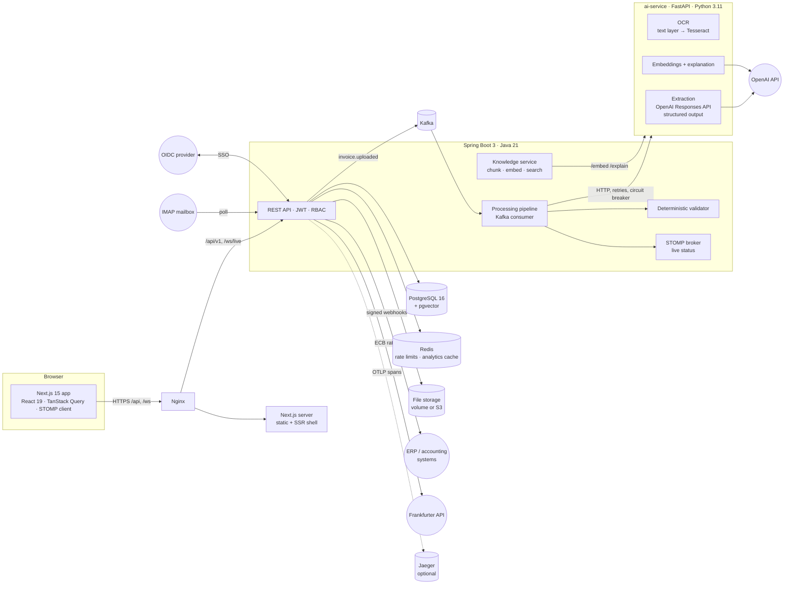
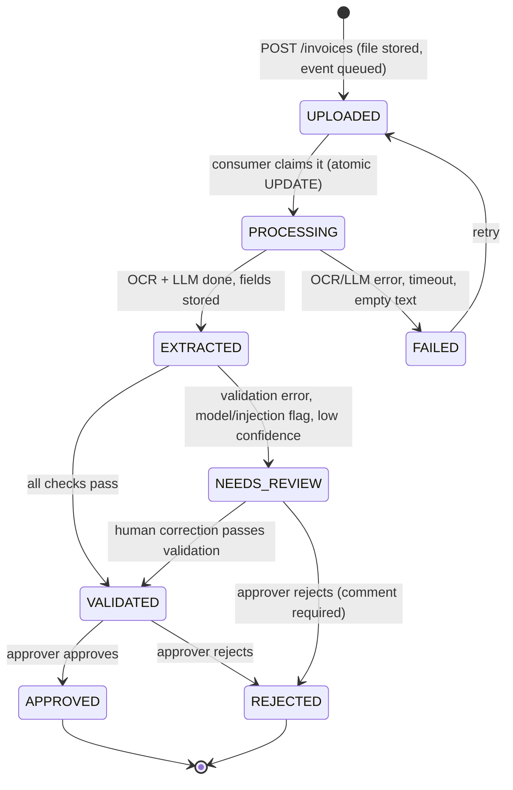
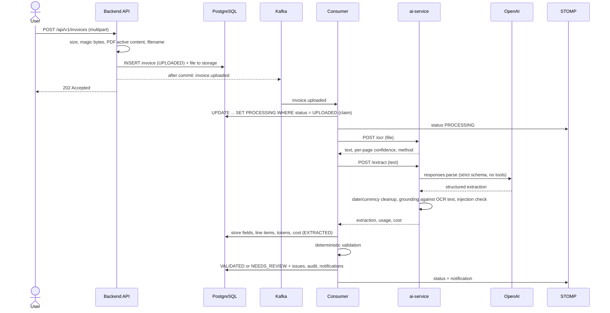
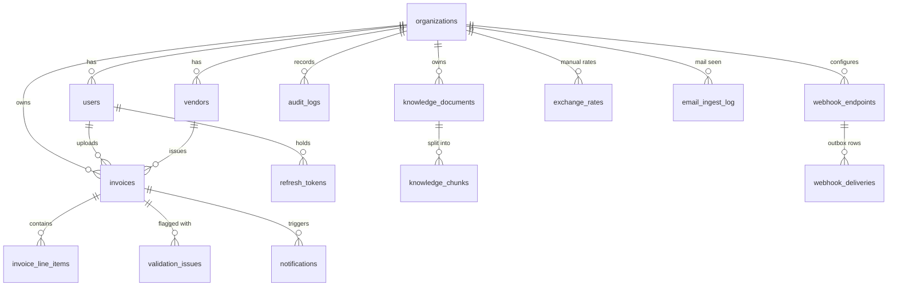

# Architecture

InvoiceMind turns an uploaded invoice (PDF or image) into validated, approvable, exportable data.
This document explains how the pieces fit together and why the main decisions were made.
Everything described here exists in the repository and is covered by tests; where something is a
limit or a trade-off it says so.

## System overview

| Service | Role | Stateful? |
|---|---|---|
| `nginx` | Only published entry point (port 80). Proxies `/api`, `/ws`, everything else to Next.js; 16 MB body limit; security headers | no |
| `frontend` | Next.js 15 standalone server | no |
| `backend` | Auth (password + OIDC), tenancy, invoices, approvals, analytics, currency conversion, export, audit, notifications, knowledge base, webhooks, e-mail ingestion, Kafka producer/consumer, STOMP | files on a volume, or none when S3 is used |
| `ai-service` | OCR (Tesseract, optionally PaddleOCR) and every call to OpenAI. The backend never talks to OpenAI directly | no |
| `postgres` | System of record, plus vector search (pgvector) | yes |
| `kafka` | Durable queue between "uploaded" and "processed" | yes |
| `redis` | Rate limiting and analytics cache; losing it loses nothing | no persistence |

## The invoice lifecycle

Status changes are pushed to the browser over STOMP and also invalidate the TanStack Query cache, so
lists, the detail page and the analytics update without polling. If the socket is down the UI falls back
to polling while an invoice is in flight.

### Upload to validated, step by step

## Decisions

### Why Kafka for processing (and not `@Async`)

Processing an invoice takes seconds to minutes and depends on two external systems. An in-process
`@Async` executor loses work when the JVM restarts, has no backpressure and no retry story, and ties
throughput to one instance. Kafka gives:

- **Durability**: the message outlives a backend crash. A lost or never-sent message is also covered:
  the `ProcessingSweeper` re-enqueues invoices still `UPLOADED` after two minutes and fails invoices stuck
  in `PROCESSING` after ten.
- **Idempotency**: delivery is at-least-once, so the consumer *claims* an invoice with a conditional
  `UPDATE ... WHERE status = 'UPLOADED'`. A duplicate delivery claims nothing and returns.
- **Scaling**: three partitions and three consumer threads; more backend instances join the same group.
- **Failure isolation**: business failures (unreadable file, model refusal, AI outage) are caught and turned
  into a `FAILED` status the user can retry. Only infrastructure failures propagate to Kafka's error handler,
  which retries twice and then publishes to `invoice.uploaded.DLT`, whose listener marks the invoice `FAILED`.
- **Publish after commit**: the event is sent from an `AFTER_COMMIT` listener, so a consumer can never see an
  invoice row that does not exist yet.

The honest cost: Kafka is heavy for a single-service product and adds an operational dependency. It is
justified here because the pipeline is the product's core and genuinely asynchronous; it is not used for
anything it does not need to be.

### Why Redis exists

Two uses, both optional in the sense that Redis being down degrades rather than breaks:

1. **Rate limiting** (fixed-window counters): login/register per IP and per e-mail, upload per user,
   refresh per IP (its own, higher bucket because every page load refreshes the session). If Redis is
   unreachable the limiter fails open and logs a warning.
2. **Analytics cache**: results are cached for five minutes under a key that embeds a per-organisation
   version counter. Any status change bumps the counter, which invalidates every cached result of that
   organisation at once, so numbers never lag behind an approval.

### Why a separate `ai-service`

OCR (Tesseract, Poppler) and the OpenAI client are Python-native, need system binaries, and change at a
different pace than the business backend. Keeping them behind two small HTTP contracts (`/ocr`, `/extract`,
plus `/embed`, `/explain`) means the backend can be tested with a stub, the OCR engine can be swapped
(`app/ocr/base.py` is the interface; Tesseract and, optionally, PaddleOCR implement it) and all LLM spending is metered in one place. The backend
authenticates to it with a shared internal token; the service is not published to the network.

### Why pgvector instead of a vector database

The knowledge base is small (an organisation's policy documents), tenant-scoped, and queried together with
relational data. pgvector in the existing PostgreSQL keeps one datastore, one backup and transactional
inserts. HNSW with cosine distance serves the queries; every search is filtered by `organization_id`.

### Credit notes are negative invoices

The model reports `document_type` (`invoice` or `credit_note`) and copies the sign as printed. The backend stores every
credit-note amount as a **negative** number whichever sign was printed (`DocumentType.signed`), so all sums (analytics,
exports, the currency conversion) net out without special cases. Validation mirrors the invoice rules (total must be below
zero, no positive subtotal or tax), duplicates are detected per document type (a credit note may legitimately repeat an
invoice's number), and a reviewer can reclassify a document; the amounts follow the type.

### Currency conversion and why it never guesses

Every rate is stored per 1 EUR (`exchange_rates.per_eur`, the ECB convention), so one table serves any reporting currency and
a cross rate is `amount / per_eur(from) * per_eur(to)`. Shared ECB rates are downloaded lazily from Frankfurter for exactly
the date range the invoices need and kept current by a scheduled job; an admin adds manual per-organisation rates for
currencies the ECB does not publish (RUB). An invoice is converted at the latest rate **on or before its own date** (ECB
rates older than 14 days are not trusted, manual rates stay valid until replaced; a manual rate wins over an ECB rate of the
same date). If no usable rate exists the invoice is reported under "not converted" with its own currency. A failed download is
recorded and shown on the Settings page, analytics keep working, and the download is retried. Only dates leave the system.

### Integrations

- **Webhooks (the ERP hook).** Events are written in the same transaction as the invoice change (transactional outbox,
  `webhook_deliveries`), then sent by a dispatcher that claims rows with `FOR UPDATE SKIP LOCKED` and a lease, so several
  backend instances can run it. Delivery is at-least-once with HMAC-SHA256 signatures over `timestamp.body`, exponential
  backoff for about an hour, a delivery log and a manual retry. URLs are fetched by the server, hence an SSRF guard: only
  http(s), no credentials, and every resolved address must be public (checked again at delivery time); redirects are never
  followed. `WEBHOOKS_ALLOW_PRIVATE_TARGETS` opens it for a receiver in the operator's own network.
- **E-mail ingestion.** One IMAP mailbox is polled; the plus-tag of the recipient address identifies the organisation, the
  sender must be one of its enabled users, attachments take the normal upload path (so every upload defence applies) and
  everything lands in review. Every message is logged; a Message-ID is never processed twice.
- **Single sign-on.** OpenID Connect authorization-code flow with PKCE implemented in the backend: signed flow cookie, ID
  token verified against the provider's JWKS (signature, issuer, expiry, audience, nonce), then the same refresh-cookie
  session as a password login. Accounts are linked by verified e-mail on the first login and then pinned to the provider's
  subject; provisioning into an organisation is opt-in and limited to configured e-mail domains.
- **Object storage.** `FileStorage` has a local-volume and an S3 implementation (same key layout); the bucket is verified at
  start-up.

### Tracing

With `TRACING_ENABLED=true` both services export OpenTelemetry spans (W3C `traceparent`). The backend's Kafka producer and
listener are observed, so the trace continues across the queue: HTTP upload → `invoice.uploaded` send/receive → the backend's
OCR and extraction calls → the ai-service's request, `ocr.process` and `llm.extract` spans (model, token counts, cost; never
document content). Log lines carry the trace id.

## Trust boundaries

| Input | Treated as | Where enforced |
|---|---|---|
| Uploaded file | hostile | magic-byte sniffing (the client's type and extension are ignored), 15 MB cap, PDF active-content scan (`/JavaScript`, `/Launch`, `/EmbeddedFile`), sanitised display name, opaque storage key, files served inline with `nosniff` and a sandbox CSP |
| OCR text | untrusted data | never concatenated into instructions; wrapped in per-request random-nonce tags; the system prompt says it is data |
| LLM output | untrusted input | strict Pydantic schema; dates and currency re-parsed; every key value must appear in the OCR text (grounding); injection detector forces review; **the backend then re-validates everything deterministically** |
| Knowledge passages | untrusted data | same tag neutralisation, the model has no tools, citations outside the supplied passages are dropped |
| JWT / `organizationId` | the only source of identity | the organisation always comes from the verified token, never from request input |
| Webhook URL | server-side request forgery risk | scheme/credential check, every resolved address must be public (re-checked at delivery), no redirects, response bodies never read or stored |
| Inbound e-mail | hostile | recipient token + sender-is-a-user check, optional dkim/spf proof, attachments through the normal upload gatekeeping, count and size caps, subject stripped of control characters |
| OIDC ID token | hostile until verified | JWKS signature, issuer, expiry, audience and nonce checked; state in a signed cookie; `next` limited to same-site paths |
| Spreadsheet cells | formula risk | exported text cells that start with `= + - @` are prefixed so Excel cannot execute them (vendor names come from OCR) |

### What the validator checks (Java, no LLM)

Required fields; ISO 4217 currency; `subtotal + tax = total` (1 cent tolerance); line items sum to the subtotal
(1 cent per line); `quantity x unit price = line total` (warning); invoice date not in the future or older
than ten years; due date not before invoice date; total greater than zero; duplicate vendor + invoice number
(the older invoice wins, so two simultaneous uploads do not flag each other); identical file already uploaded
(warning); and the model's own signals (`needs_review`, low confidence, suspected injection), which can only
*add* review work. Once a human corrected an invoice those soft signals no longer apply, but the arithmetic
rules always do.

## Security model

- **Authentication**: BCrypt passwords; 15-minute HS256 access tokens carrying user, organisation and role
  (held in memory by the SPA); 14-day refresh tokens in an `httpOnly`, `SameSite=Strict`, path-scoped cookie.
  Refresh tokens are stored hashed, **rotate on every use**, and presenting an already-used token revokes
  every session of that user (theft detection). `/auth/refresh` and `/auth/logout` additionally require a
  custom header cross-site forms cannot send.
- **Authorisation**: roles `USER`, `APPROVER`, `ADMIN`. A `USER` only ever sees invoices they uploaded;
  reviewers see the organisation. Foreign and unknown ids are indistinguishable (404). The permission flags
  (`canEdit`, `canApprove`...) are computed on the server and the UI only renders them.
  Approvers cannot approve their own uploads (four-eyes); admins can (documented break-glass).
- **Tenancy**: tenant = organisation, resolved from the JWT. A registration creates a new organisation and its
  first admin.
- **WebSocket**: authenticates in the STOMP `CONNECT` frame, may only subscribe to the user's own queues and (for
  reviewers) their organisation's topic, and may not publish.
- **Audit**: uploads, processing steps, corrections (with before and after), decisions, exports, team and
  knowledge changes, each with actor and time. System actions are attributed to "System".
- **Single sign-on** creates the same refresh-cookie session as a password login; the provider subject is pinned to the account on first use, so a reassigned e-mail address cannot take it over.
- **Secrets** come from environment variables only; compose refuses to start without the required ones.

Known limits are listed in the README.

## Data model

`invoices` also stores the OCR text, the raw model output (JSON), model name, input/output tokens, cost in USD,
processing time and the decision (who, when, comment); `knowledge_chunks.embedding` is `vector(1536)`. `invoices.document_type` is `INVOICE` or `CREDIT_NOTE` (the latter stored negative); `organizations` carries the reporting currency and the e-mail ingestion token; shared ECB rates are rows of `exchange_rates` without an organisation.

## Observability

Every request carries an `X-Request-ID` (accepted if well-formed, otherwise generated), placed in the logging
context and forwarded to the ai-service, so one upload can be followed across services. Backend logs are
structured JSON (ECS format) in Docker; the ai-service logs one JSON object per line and **never logs document
content**, only sizes and a hash. Processing time, token usage and estimated cost are persisted per invoice and
aggregated on the analytics page. With `TRACING_ENABLED=true` a trace spans backend, Kafka and ai-service (see Tracing above). Health checks: `/actuator/health/readiness` (backend), `/health` (ai-service).

## Testing strategy

| Layer | What | Where |
|---|---|---|
| Unit | validator rules, file gatekeeping, JWT, export safety, chunker, AI client retries and circuit breaker | `backend/src/test` |
| Integration | full application on real PostgreSQL (pgvector), Kafka and Redis via Testcontainers: auth, tenancy, pipeline, approvals, analytics, exports, WebSocket, knowledge, credit notes, currency conversion, webhooks, tracing propagation; plus real protocol servers: IMAP (GreenMail), OIDC (mock-oauth2-server), S3 (SeaweedFS) | `backend/src/test` (`*IT`) |
| Service | OCR on real Tesseract/Poppler, extraction with a fake OpenAI client, injection and hallucination cases, error mapping | `ai-service/tests` (run in Docker) |
| Frontend unit | formatting, live arithmetic, token refresh single-flight, API errors, components | `frontend/src/**/*.test.ts(x)` |
| End to end | a real browser against the whole stack | `frontend/e2e` |
| Quality | field-level accuracy of the real pipeline on 16 documents with ground truth | `eval/` → `docs/EVALUATION.md` |

The only test doubles are named as such (`FakeAiServiceForTests`, `FakeOpenAIClientForTests`,
`e2e/fake-ai`) and live in test code or the e2e overlay. Nothing in the production code path is simulated.
